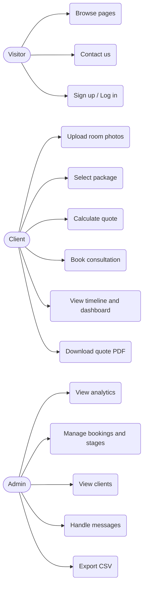
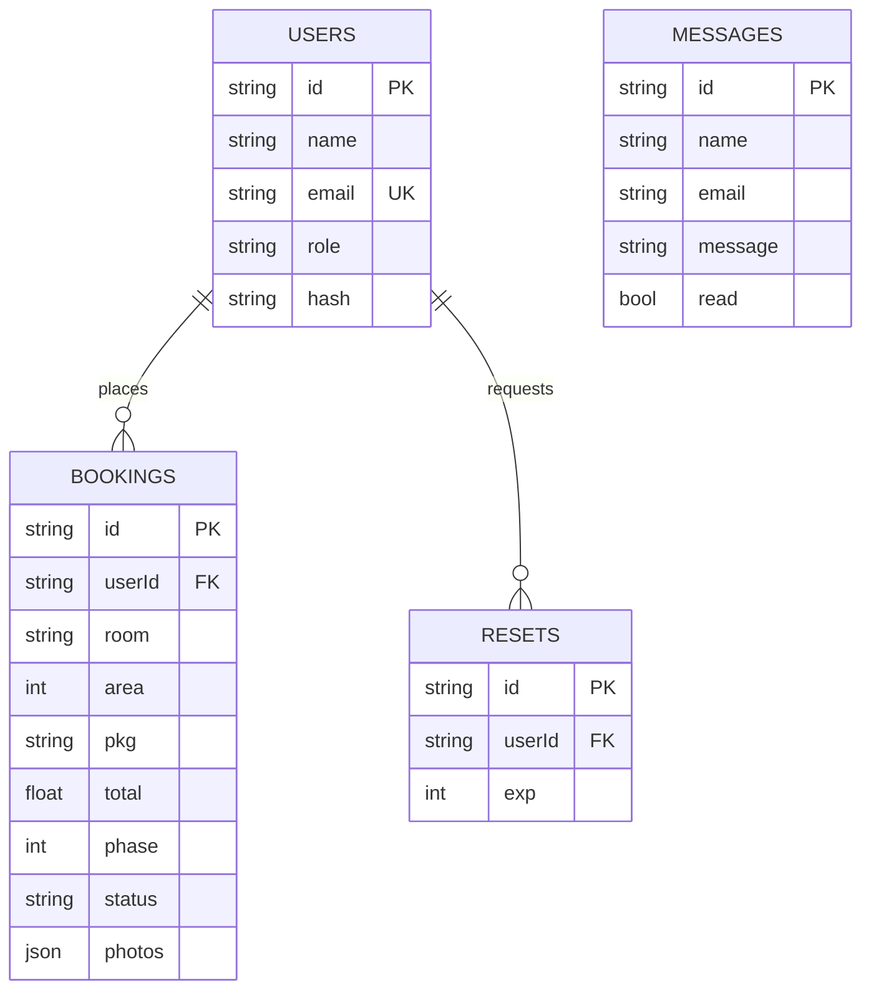
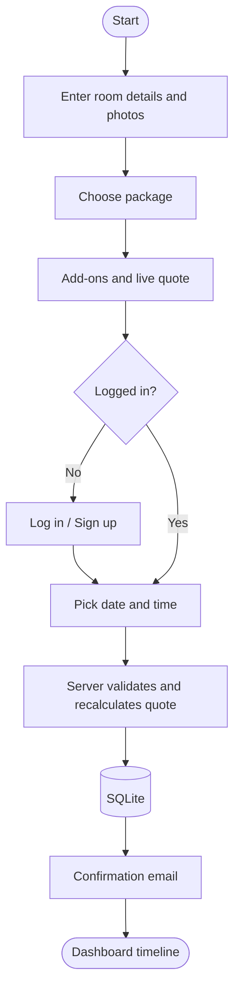
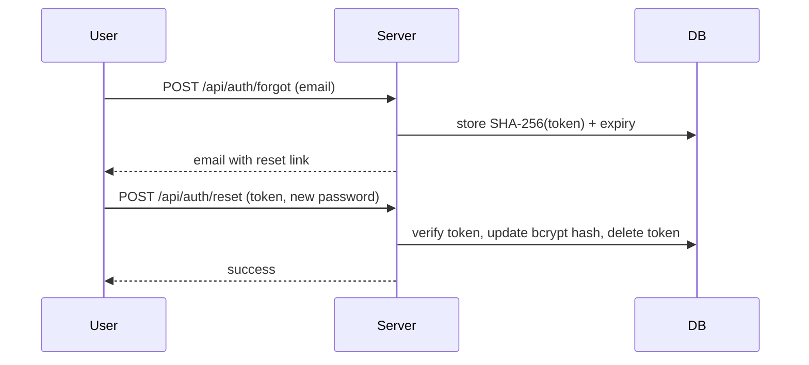

# Project Report Pack: Aura Space

## 1. Suggested report outline
1. Introduction (problem, objectives, scope)  2. Literature / existing systems  3. Requirement analysis (functional, non-functional)  4. System design (diagrams below)  5. Implementation (stack, modules, key code)  6. Testing (table below)  7. Results (screenshots)  8. Conclusion and future work  9. References

## 2. Requirements
**Functional:** user registration/login · room photo upload · design package selection · quote calculator · consultation booking · project timeline · client dashboard · admin dashboard (bookings, clients, messages, analytics) · password reset · email confirmation · dark mode / RTL.
**Non-functional:** responsive UI, password hashing, role-based access, server-side validation, accessible controls, fast page loads.

## 3. Use-case diagram

## 4. ER diagram

## 5. Booking flow

## 6. Sequence: password reset

## 7. Test cases
| ID | Scenario | Expected |
|---|---|---|
| T1 | Sign up with existing email | 409 error shown |
| T2 | Password under 6 chars | Rejected |
| T3 | Book while logged out | Prompted to log in; selections kept |
| T4 | Client requests another user's booking | Not returned |
| T5 | Client calls `PATCH /api/bookings/:id` | 403 Forbidden |
| T6 | Tamper quote in request body | Server recalculates total |
| T7 | Expired/invalid reset token | Error message |
| T8 | Admin changes stage | Client timeline updates |
| T9 | Toggle dark / RTL, reload | Preference persists |
| T10 | Export CSV with filter | Only filtered rows exported |

## 8. Future work
Payments (Stripe/Razorpay), cloud image storage, calendar sync, real-time chat with the designer, PostgreSQL + Prisma, automated tests (Jest/Playwright).
